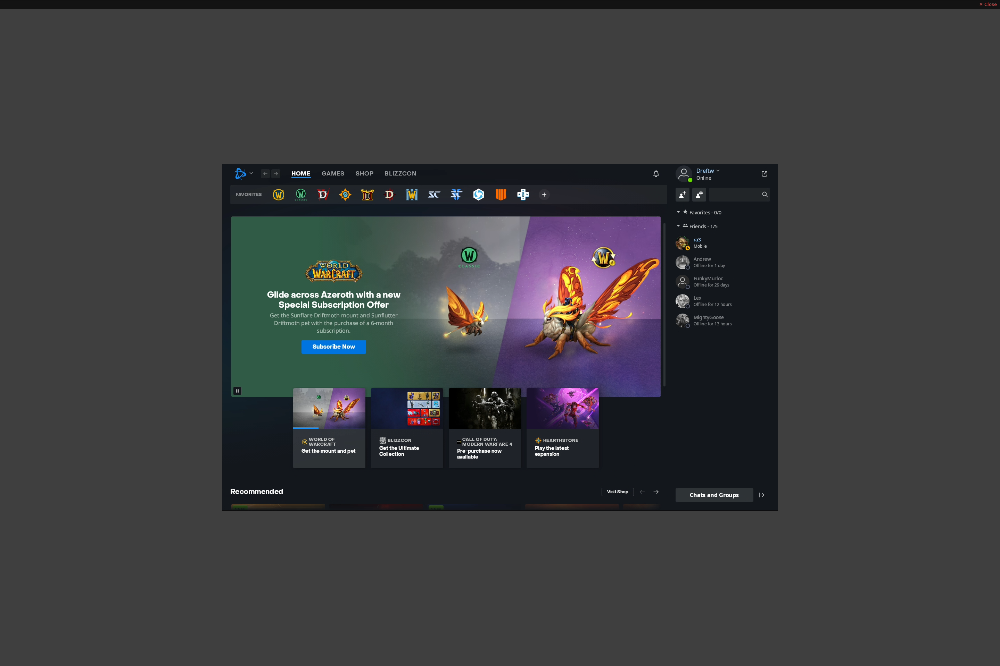

# Battle.net



Blizzard's game launcher for World of Warcraft, Diablo, Overwatch, Call of Duty, and more.

## How it works

Battle.net runs through [umu-launcher](https://github.com/Open-Wine-Components/umu-launcher) with GE-Proton in the Steam Linux Runtime (the same stack the Lutris image uses), so games get Proton's DXVK and vkd3d-proton (DX11 and DX12).

Everything is baked into the image at build time, so nothing is downloaded when the app starts: GE-Proton (pinned), the Steam Linux Runtime, a Proton-created prefix and a complete Battle.net installation. On first launch the prefix is copied to the persistent mount, so logins and installed games survive restarts. The image is run by any uid:gid Wolf is configured with (`run_uid`/`run_gid` of the paired client); the persistent mount must be writable for that uid.

## Configuration

pressure-vessel (the Steam Linux Runtime sandbox) needs more than the default Wolf runner settings: no seccomp/AppArmor confinement, a few capabilities and the host IPC namespace. With the host IPC namespace `/dev/shm` is a large tmpfs, which the image uses for pressure-vessel's per-launch runtime copy; it is what makes start-up take seconds instead of minutes.

```toml
[[profiles.apps]]
title = "Battle.net"
start_virtual_compositor = true

    [profiles.apps.runner]
    type = "docker"
    name = "WolfBattlenet"
    image = "ghcr.io/games-on-whales/battlenet:edge"
    # Optional: a shared games folder (see below). Without any mount the prefix and the
    # login live in Wolf's per-profile home folder, so each profile is separate by default.
    mounts = ["/path/to/games:/games:rw"]
    env = [
        "GOW_REQUIRED_DEVICES=/dev/input/* /dev/dri/* /dev/nvidia*",
        "XDG_RUNTIME_DIR=/tmp/runtime-retro",
        "RUN_SWAY=true"
    ]
    base_create_json = """
    {
      "HostConfig": {
        "IpcMode": "host",
        "CapAdd": ["SYS_ADMIN", "SYS_NICE", "SYS_PTRACE", "NET_RAW", "MKNOD", "NET_ADMIN"],
        "SecurityOpt": ["seccomp=unconfined", "apparmor=unconfined"],
        "DeviceCgroupRules": ["c 13:* rmw", "c 244:* rmw"]
      }
    }
    """
```

## Notes

- First launch copies the prefix to a persistent folder (a few seconds on SSD/ZFS): `/home/retro-persist` when that is mounted, otherwise `~/.bnet` in the per-profile home that Wolf mounts at `/home/retro`, so a new profile needs no extra setup. It is owned by the uid Wolf runs the container with.
- The Battle.net launcher UI is GPU-rendered (`HardwareAcceleration=true`, set in the baked `Battle.net.config`); games use the GPU through Proton.
- `/dev/shm` needs about 1.5 GB free for the runtime copy; with less (e.g. without `IpcMode: host`, Docker's default is 64 MB) the image falls back to a slow directory in the persistent mount.
- Optional shared game library: mount a host directory at `/games` (e.g. `/path/to/games:/games:rw`) and it appears as drive `D:` in the prefix, also inside the Steam Linux Runtime sandbox. Install games to `D:\` in Battle.net. Several users can mount the same directory, but only one should run or update the games at a time.
- Per-user World of Warcraft data: every installed WoW flavor (found by its `.flavor.info`, wherever it is installed) gets its own `WTF` and `Interface/AddOns`, bind-mounted from `/userdata/wow/<flavor>/{WTF,AddOns}` when a folder is mounted at `/userdata`, otherwise from `~/userdata` in the per-profile home. The mounts exist inside that container only, so users share the game files but not settings or addons. Needs `CAP_SYS_ADMIN` (already in the runner settings above). A new user starts with empty folders. A flavor is mounted as soon as its install looks finished (`.flavor.info` plus a `Wow*.exe`): at start and then every 5 s (`BNET_USERDATA_INTERVAL`), so a game installed during the session is covered before its first launch. `BNET_USERDATA_WATCH=0` turns the watcher off and `BNET_USERDATA_DISABLE=1` (environment variable of the app) turns the whole feature off; what it mounted is logged to `/tmp/bnet-userdata.log` in the container.
- In Battle.net, set Settings > App > "When I close Battle.net" to "Exit Battle.net completely" (the default minimizes to the system tray, and a client in the tray keeps the session open).
- The session ends on its own once the Battle.net client has been closed for 4 s and no game is left running (a helper a game leaves behind would otherwise keep the container open). Disable with `BNET_AUTO_EXIT=0`, change the wait with `BNET_EXIT_GRACE` (seconds) or the helper processes to ignore with `BNET_EXIT_IGNORE` (regex) in `bnet.env`; blockers are logged to `auto-exit.log` in the persistent mount.
- Diagnostics are off by default. `export BNET_DEBUG=1` in `bnet.env` (in the persistent mount) writes `session-trace.log` (timeline of Windows processes and windows) and `umu-last.log` (launcher output; the end of it is printed to the container log when a start fails). The previous run is kept as `.1`.
- Extra environment can be set in `bnet.env` in the persistent folder (sourced by the start script before launching).
- Tested on AMD (Mesa/radv). The image is installed with the `enUS` language; the in-app region and language can be changed after logging in.
